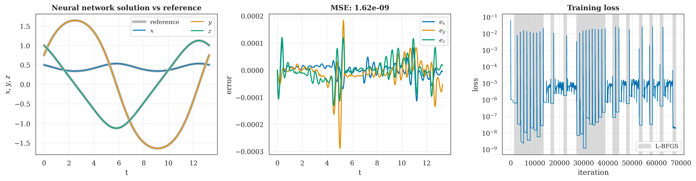

# Lorenz-1960 windowed causal PINN

This repository trains a physics-informed neural network directly from the
Lorenz-1960 ordinary differential equations. The final method divides one
closed orbit into 27 causal time windows, transfers the endpoint state between
windows, and warm-starts each network from the preceding window's weights.

The selected saved run uses 1,536 effective uniform collocation points per
window and float64 arithmetic. Its final checkpoint reproduces a combined state
RMSE of `6.96696531e-5` and a maximum state error of `3.09323169e-4` over
`t = [0, 13.26446]`.



## Final training configuration

| Setting | Value |
|---|---:|
| Network per window | 4 hidden layers x 60 tanh units |
| Windows | 27 |
| Effective points per window | 1,536 |
| Precision | float64 |
| Causal epsilon schedule | 0.01, 0.1, 1, 10 |
| Causal threshold | 0.99 |
| Adam cap | 4,000 steps per epsilon stage |
| L-BFGS cap | 1,000 iterations per window |
| Warm start | enabled |
| Recorded device | CUDA |
| Recorded wall time | 881.08 seconds |

Windows 10 and 11 reached the Adam cap during epsilon 10 with minimum weights
`0.9718467` and `0.9031337`. L-BFGS completed afterward, so the saved run is
complete, but those two stages did not satisfy the causal threshold.

## Run or reload the final result

```bash
python -m pip install -r requirements.txt
python run_causal.py
```

The command reuses the committed final result when its scientific configuration
matches. Remove or relocate the active run directory only when intentionally
starting a new training run.

To evaluate a saved run without retraining:

```bash
python run_eval.py runs/active/windowed-causal-1536pt
```

`colab.ipynb` provides the same entry point for Google Colab.

## Three active experiments

| Run | Purpose | Combined RMSE |
|---|---|---:|
| [Windowed causal 1536](runs/active/windowed-causal-1536pt/README.md) | Selected final result | `6.96697e-5` |
| [Shared-network causal](runs/active/shared-network-causal-negative/README.md) | Negative ablation | `3.98125e-1` |
| [Sequential walk T=10](runs/active/sequential-walk-t10-negative/README.md) | Negative long-horizon comparison | `2.05793` |

Every active run has its own available histories, metrics, summaries, and
figures. The final and shared-network runs also have checkpoints. The
sequential-walk checkpoint was not saved in its source branch. Other unique
experiments are retained under
[runs/archive](runs/archive/README.md).

## Method

For state `u(t) = [x(t), y(t), z(t)]`, the network minimizes the mean squared
ODE residual

```text
r(t) = du/dt - f(u(t)).
```

Automatic differentiation computes `du/dt`. A hard trial function enforces the
initial condition of each window exactly. Within a window, causal weights reduce
the influence of later points until earlier residuals are small:

```text
w_i = exp(-epsilon * sum(L_k for k < i)).
```

After a window finishes, its predicted endpoint becomes the next window's exact
initial-condition anchor. Network weights are copied forward as initialization,
while the trained per-window models are retained for prediction over the full
orbit.

## Repository layout

```text
src/pinn/
  config.py              configuration and reference access
  pinn.py                PINN and WindowedPINN models
  train.py               single-domain and windowed training
  functions/             collocation, residual, optimizer, and trial functions
  viz/                   evaluation and visualization
  test_pinn.py           regression and numerical tests
src/baseline/            DOP853 reference solver
runs/active/             the three key experiments
runs/archive/            isolated historical experiments
run_causal.py            final training/reload entry point
run_eval.py              saved-checkpoint evaluator
colab.ipynb              Colab entry point
```

## Interpretation limits

- These are single-seed experiments. They do not estimate run-to-run variance.
- The 1,500-point and 1,536-point candidates also changed L-BFGS budgets and ran
  on different devices, so their timing and accuracy differences do not isolate
  collocation density.
- A low physics residual alone is not proof of the correct trajectory. The
  repository therefore reports reference error, dense residual, invariant
  drift, and error over time.
- The sequential-walk and shared-network runs are retained as negative results;
  they are not alternative final implementations.

See [the PR #11 audit](docs/reviews/pr-11-audit.md),
[the historical design record](docs/superpowers/specs/2026-09-21-long-horizon-precision-and-causal-design.md),
and [the earlier causal-window audit](docs/results/2026-09-22-two-branch-code-audit.md)
for the detailed experimental history.
